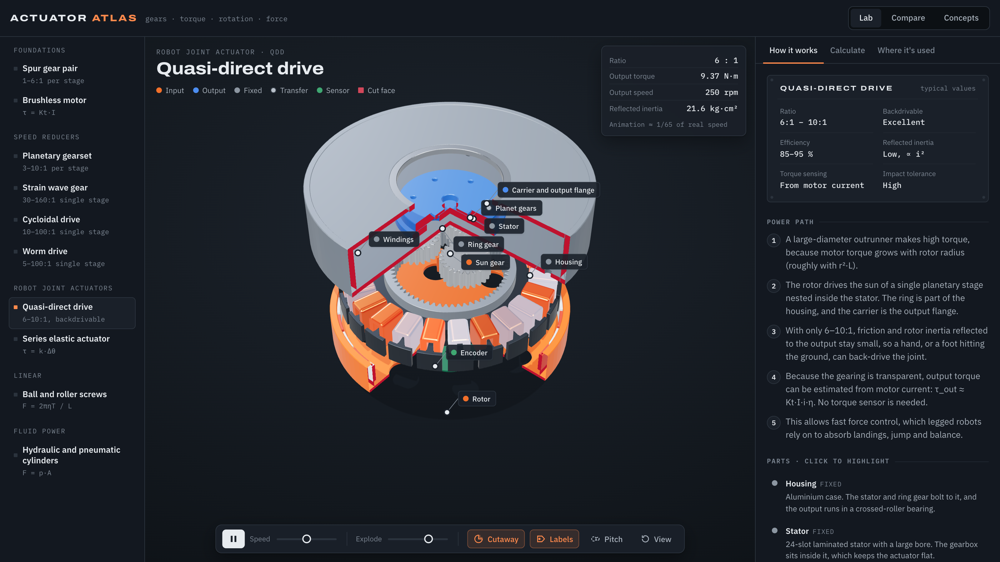

# Actuator Atlas

**How robot and industrial actuators actually work, in interactive 3D.**

**Live:** https://zerotimedrift.github.io/actuator-atlas/



Ten mechanisms you can orbit, cut open, explode and drive. The gears mesh at their true ratios, and every number on the datasheet comes from a formula you can see.

| Group | Mechanisms |
|---|---|
| Foundations | Spur gear pair · Brushless outrunner motor (live three-phase commutation) |
| Speed reducers | Planetary gearset (switch the fixed member) · Strain wave / harmonic drive · Cycloidal drive · Worm drive |
| Robot joint actuators | Quasi-direct drive (QDD) · Series elastic actuator (SEA) |
| Linear | Ball screw · Planetary roller screw · Lead screw |
| Fluid power | Hydraulic and pneumatic cylinders |

## What you can do

- **Watch it move.** Involute gear profiles, a cycloid disc that wobbles against its pins, and a flexspline that deforms in real time.
- **Cut it open.** Quarter-section cutaway with red section faces, an exploded view, and pitch circles with the line of action.
- **See the roles.** Parts are coloured by function: input, output, fixed, elastic, sensor. Hover any part to find out what it does.
- **Run the numbers.** Change tooth counts, the fixed member, lead, pressure or spring stiffness. Results show the formula with your values filled in.
- **Compare.** Why legged robots use 6–10:1: output torque, speed and reflected inertia (∝ i²) for one motor at any ratio, plus a side-by-side table and a picking guide.
- **Learn the vocabulary.** Backlash, backdrivability, reflected inertia, Kv/Kt, self-locking and more, each linked to a mechanism.

## Run locally

It's a static site with no build step:

```bash
python3 -m http.server 8000
```

Then open http://localhost:8000.

Built with [three.js](https://threejs.org) r147. Specs are typical catalogue ranges for learning, not data for any specific product.
